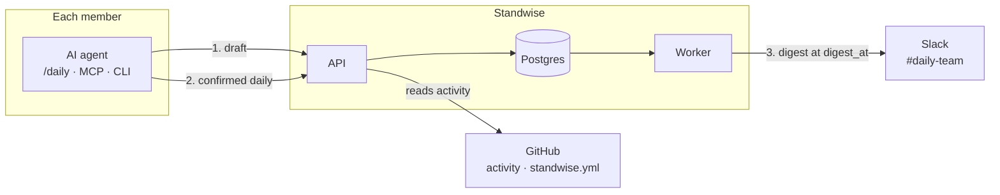

<p align="center">
  
</p>

<h1 align="center">Standwise</h1>

<p align="center">
  <strong>Your team's daily standup, written with your AI agent and delivered to Slack.</strong>
</p>

<p align="center">
  <a href="https://github.com/ImFelipeOliveira/standwise/actions/workflows/ci.yml"></a>
  <a href="https://github.com/ImFelipeOliveira/standwise/releases"></a>
  
  <a href="LICENSE"></a>
  <a href="https://www.typescriptlang.org"></a>
  <a href="https://bun.sh"></a>
  <a href="https://modelcontextprotocol.io"></a>
</p>

<p align="center">
  <a href="#quick-start">Quick start</a> ·
  <a href="https://standwise.usefachada.dev">Landing</a> ·
  <a href="https://docs-standwise.usefachada.dev/">Documentation</a> ·
  <a href="https://docs-standwise.usefachada.dev/admin/configuration">Configuration</a> ·
  <a href="#roadmap">Roadmap</a>
</p>

---

> [!WARNING]
> **Public beta.** Standwise is being tested with its first teams. Expect rough edges and changes to behaviour, configuration and the API before 1.0. Report problems in [GitHub issues](https://github.com/ImFelipeOliveira/standwise/issues) or at support.standwise@usefachada.dev.

Each person runs `/daily` in their AI agent (Claude Code, Cursor, Codex, Claude Desktop, VS Code). Standwise drafts the daily from what they did on GitHub; the person edits it, adds today's plan and blockers, and **confirms before anything is sent**. At the time set in `standwise.yml`, Standwise posts one digest per team to Slack.

It is built for teams, not for watching people: **no productivity metrics, no rankings, nothing sent on anyone's behalf.**

## Table of contents

- [Why Standwise](#why-standwise)
- [Features](#features)
- [How it works](#how-it-works)
- [Quick start](#quick-start)
- [Configuration](#configuration)
- [Privacy principles](#privacy-principles)
- [Architecture](#architecture)
- [Self-hosting](#self-hosting)
- [Development](#development)
- [Contributing](#contributing)
- [Roadmap](#roadmap)
- [Support](#support)
- [License](#license)

## Why Standwise

Once a team writes dailies with AI, three problems show up:

- **Loose dailies.** Every message comes in a different format, in a different place.
- **No consolidated view.** The manager reads scattered messages and has no single picture of the team.
- **Nobody orchestrates.** No one tracks who sent the daily, and blockers sit until someone notices.

Standwise keeps the writing where people already work, inside their agent, and takes care of collecting, consolidating and delivering.

## Features

- **Draft from GitHub activity.** Pull requests opened, merged and reviewed, plus commits grouped by repository, since your last daily. Monday covers the weekend.
- **Works in any MCP client.** A Claude Code plugin with the `/daily` skill, an MCP server for Cursor, Codex, Claude Desktop and VS Code, and a plain CLI for the terminal.
- **One digest per team.** Posted to Slack at `digest_at`, in the team's time zone and only on workdays, with blockers first and the people who did not send listed at the end.
- **Late dailies.** Sent after the digest, they are posted as a reply in the digest thread.
- **Reminders.** At `remind_at`, people who have not sent their daily get one direct message, at most once a day, and never after the digest.
- **Blocker routing.** A new blocker goes by direct message to whoever can help: the pull request's reviewers, then its CODEOWNERS, then the team managers.
- **Linear cards.** Connect one Linear workspace (read-only) and your own cards that started or finished appear in your draft. A blocker that links a card goes to the people who own the blocking card.
- **Suggested blockers, only for you.** A pull request waiting too long for review, CI failing for a day or a card in progress for days shows up in your own draft. You confirm or ignore it; nobody else ever sees it.
- **Several teams, one daily.** People in two teams write once and appear in both digests.
- **Configuration as code.** A single `standwise.yml` in your `.github` repository. Every push and pull request that changes `standwise.yml` is validated by a `Standwise config` check run with the error on the right line, and an invalid push never breaks anything: the last valid version stays in effect.
- **Manager tools.** Managers read their team's dailies, digests and blockers from their own AI agent.
- **Read-only API and webhooks.** API keys (`swk_…`), an OpenAPI reference, and signed outgoing webhooks such as `daily.submitted` and `blocker.opened`.
- **Bilingual.** English and Brazilian Portuguese across the CLI, Slack messages, web pages and documentation.

## How it works



A day with `remind_at: "09:30"` and `digest_at: "10:00"`:

| Time  | What happens                                                                                                                                                                                                  |
| ----- | ------------------------------------------------------------------------------------------------------------------------------------------------------------------------------------------------------------- |
| 08:50 | Alice runs `/daily`. Her agent fetches a draft of yesterday's GitHub work; she edits it, writes today and one blocker, and confirms. Her blocker links a pull request, so its reviewer gets a direct message. |
| 09:30 | Bob has not sent yet, so he gets a reminder.                                                                                                                                                                  |
| 10:00 | Standwise posts the team digest to `#daily-backend`: blockers first, then each person's yesterday and today, then who did not send.                                                                           |
| 10:40 | Bob sends a late daily. It is posted as a reply in the digest thread.                                                                                                                                         |

The full walkthrough is in [How it works](https://docs-standwise.usefachada.dev/how-it-works).

## Quick start

New here? The [landing page](https://standwise.usefachada.dev) has the overview and the beta request form. Agents can read [llms.txt](https://standwise.usefachada.dev/llms.txt).

### For admins

You need to own the GitHub organization (or personal account).

1. [Install the Standwise GitHub App](https://github.com/apps/standwise-daily/installations/new) on your organization.
2. Open the setup page that GitHub sends you to, sign in, and click **Connect Slack**.
3. Create `standwise.yml` at the root of your `.github` repository, from the template on the setup page.

Step by step: [Install](https://docs-standwise.usefachada.dev/admin/install).

### For members

Install the CLI (macOS and Linux) and sign in:

```sh
curl -fsSL https://api-standwise.usefachada.dev/install.sh | sh
standwise login
```

The script downloads the latest release for your system, checks it against `SHA256SUMS` and installs it to `~/.local/bin/standwise`. Windows binaries are on the [releases page](https://github.com/ImFelipeOliveira/standwise/releases/latest).

Then pick how you write your daily:

| Client                                     | Setup                                                                                                               |
| ------------------------------------------ | ------------------------------------------------------------------------------------------------------------------- |
| **Claude Code**                            | `/plugin marketplace add ImFelipeOliveira/standwise`, then `/plugin install standwise@standwise`, then run `/daily` |
| **Cursor, Codex, Claude Desktop, VS Code** | Add the MCP server (`standwise mcp`): [MCP guide](https://docs-standwise.usefachada.dev/members/mcp)                |
| **Terminal**                               | `standwise draft` and `standwise submit`: [CLI reference](https://docs-standwise.usefachada.dev/members/cli)        |

## Configuration

All configuration lives in `standwise.yml` at the root of the `.github` repository, on the default branch:

```yaml
teams:
  - name: backend
    timezone: America/Sao_Paulo
    remind_at: "09:30"
    digest_at: "10:00"
    managers: [alice]
    members: [alice, bob]
    chat:
      provider: slack
      channel: "#daily-backend"
```

Every key is documented in the [configuration reference](https://docs-standwise.usefachada.dev/admin/configuration).

## Privacy principles

- **Your code is never read.** Standwise reads `standwise.yml`, team and organization membership, and the titles, links and dates of your own pull requests, reviews and commits. If you connect Linear, it also reads card titles, links, states and dates, never descriptions or comments.
- **Nothing is sent without your confirmation.**
- **No rankings, scores or productivity metrics**, in any plan, ever.
- **No AI model processes your data on the Standwise servers.** The writing happens in your own agent.
- **Secrets are encrypted at rest** with AES-256-GCM.

Details: [Privacy](https://docs-standwise.usefachada.dev/privacy).

## Architecture

A Bun + TypeScript monorepo. Business rules live in use cases; HTTP routes, jobs, the CLI and the MCP server are thin layers on top of them.

```text
apps/
├── api/            Hono HTTP API, GitHub and Slack webhooks, setup pages, /reference
├── worker/         pg-boss jobs: tick, digests, late dailies, webhook delivery
└── cli/            standwise CLI and MCP server (compiled to a single binary)
packages/
├── core/           pure domain: config, calendar, digest builders, i18n
├── orchestrator/   use cases: drafts, submissions, digests, org reads
├── db/             Drizzle schema, migrations and repositories (Postgres)
├── queue/          job queue port and pg-boss implementation
├── plugin/         Claude Code plugin with the /daily skill
└── adapters/
    ├── github/     GitHub App: activity, config, teams, OAuth
    └── slack/      Slack: OAuth, digests, threads, direct messages
docs/
├── site/           VitePress documentation (en and pt-BR), hosted on Cloudflare Pages
└── api/            OpenAPI guides and changelog
```

Dependency direction: `apps → orchestrator → core`, with `db`, `queue` and the adapters behind ports so use cases are tested without HTTP, Slack or GitHub.

## Self-hosting

Standwise ships as one Docker image containing the api and the worker. `APP` (`api` or `worker`) selects the default command. The documentation site is not part of the image: it is a static site on Cloudflare Pages, see [docs/cloudflare-pages.md](docs/cloudflare-pages.md).

```sh
docker build --build-arg APP=api -t standwise-api .
docker build --build-arg APP=worker -t standwise-worker .
```

- The api runs the migrations on startup, so run a single api replica. Both services need Postgres.
- Every variable is listed in [`.env.example`](.env.example).
- Railway setup: [docs/deploy.md](docs/deploy.md).
- Register the apps with [docs/github-app.md](docs/github-app.md) (or [the manifest](docs/github-app-manifest.json)), [docs/slack-app-manifest.yml](docs/slack-app-manifest.yml) and [docs/linear-app.md](docs/linear-app.md). `LINEAR_CLIENT_ID` and `LINEAR_CLIENT_SECRET` are required on the api and the worker.

## Development

```sh
cp .env.example .env
docker compose up -d        # Postgres for development and tests
bun install
bun test                    # full suite, no network needed
bun run lint                # Biome, CI-enforced
bun run typecheck           # tsc, CI-enforced
```

Documentation site, served at the root of its own domain (`https://docs-standwise.usefachada.dev` for now). `STANDWISE_PUBLIC_URL` sets the api address shown in the examples and the API reference link:

```sh
SUPPORT_EMAIL=you@example.com bun run docs:dev
SUPPORT_EMAIL=you@example.com bun run docs:build
bun run check-docs
```

### Release automation

- CI (lint, typecheck, tests against Postgres, docs build) runs on every pull request and on pushes to `dev` and `main`.
- Feature branches merge into `dev`; `dev` merges into `main` when a release is ready.
- [release-please](https://github.com/googleapis/release-please) keeps a release PR open on `main` from [Conventional Commits](https://www.conventionalcommits.org). Merging it tags the release and uploads the CLI binaries and `SHA256SUMS`.

## Contributing

Contributions are welcome. Read [CONTRIBUTING.md](CONTRIBUTING.md) for commit conventions, releases, local setup and code style before opening a pull request.

## Roadmap

- [x] Drafts from GitHub activity, through the skill, the MCP server and the CLI
- [x] Team digest and late dailies in Slack
- [x] Manager tools, read-only API and outgoing webhooks
- [x] Reminder for people who have not sent their daily
- [x] Blocker routing to reviewers, CODEOWNERS or managers
- [x] Suggested blockers (pull request without review, failing CI), visible only to you
- [x] `standwise.yml` validation as a GitHub check run
- [x] Linear integration: cards in the draft, card blocker routing and stale card suggestions
- [ ] Jira and Google Chat

## Support

Questions and problems: [support.standwise@usefachada.dev](mailto:support.standwise@usefachada.dev).

## License

[MIT](LICENSE) © 2026 Felipe Oliveira
